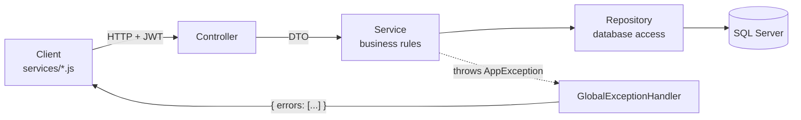

# Architecture

## Request flow (Server)



| Layer | Folder | Does | Never does |
|---|---|---|---|
| Controller | `Controllers/` | Receives the HTTP request, applies `[Authorize]`, calls one service method and returns the result | Business rules, database access, try/catch |
| DTO | `DTOs/` | Shapes what goes over the wire and validates input with `[Required]` and similar attributes | Logic |
| Service | `Services/` | Business rules, decides what is allowed, throws `AppException` | Touch `DbContext` directly |
| Repository | `Repository/` | Database queries and saves | Business rules |
| Model | `Models/` | EF Core entities, which become tables | Get returned to the Client directly |
| Mapper | `Mappers/` | Converts Model to DTO | Database access |

Every service has an interface in `Interfaces/`, so tests can replace its dependencies with mocks.

## Errors

All errors have one shape: `{ "errors": ["message"], "traceId": "..." }`.

| Exception | Status |
|---|---|
| `BadRequestException` | 400 |
| `UnauthorizedException` | 401 |
| `ForbiddenException` | 403 |
| `NotFoundException` | 404 |
| `ConflictException` | 409 |
| `AccountLockedException` | 423 |
| Anything else | 500 with a generic message. Details go to the log only. |

DTO validation failures, JWT failures (401/403) and rate limiting (429) produce the same shape. The Client turns every error into `{ status, errors }` in `api/apiClient.js`.

## Client

```
Component / Page  →  services/*.js  →  api/apiClient.js  →  /api (Vite proxy)  →  Server
                 ↘  context/AuthContext (who is signed in)
```

## Settings

Each `appsettings` section binds to a class in `Options/` and is validated at start-up. A missing JWT secret or an invalid time zone stops the API immediately with a clear message.

## Differences from HRConnect

| HRConnect | SingularExpress | Why |
|---|---|---|
| Payroll period rolls over automatically on the 1st (Quartz job) | SuperUser clicks "Roll over" | Requirement: rollover triggered by a SuperUser only |
| Lockout counters in server memory | Stored on `User` in the database | Survive restarts and work with more than one server |
| Reset PIN: 4 digits, `new Random()`, stored in plain text, **returned in the API response** | 6 digits, cryptographic RNG, stored hashed, never returned | The old design let anyone reset anyone's password |
| Password reuse check compared salted hashes, which never match | Verifies the new password against old hashes | The old check could not work |
| Different errors for "no user" and "wrong password" | Identical errors | Stops account enumeration |
| HTTPS redirection commented out | On | Credentials must not travel in clear text |
| Test packages referenced by the API project | Only in the test project | Test code should not ship |
| Create React App | Vite | CRA is deprecated |
