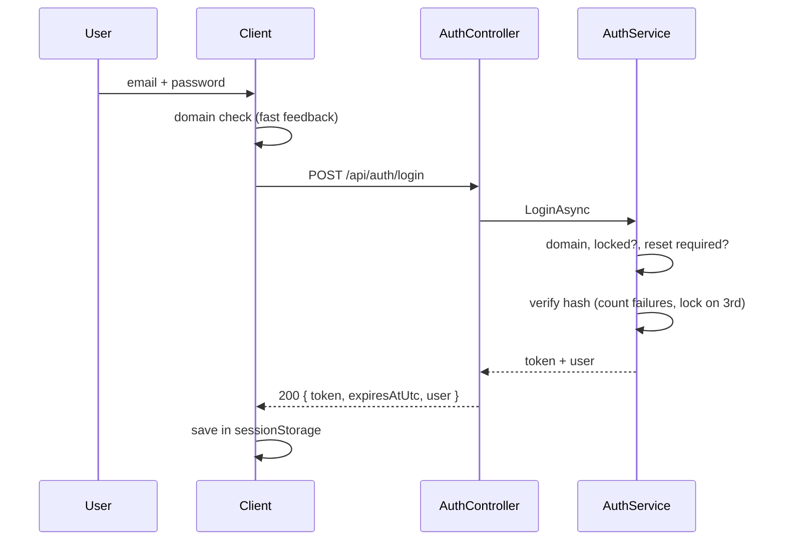

# Authentication

The rules are copied from HRConnect, with its security gaps closed (see ARCHITECTURE.md).

## Rules
| Rule | Value | Setting |
|---|---|---|
| Allowed email domain | `@singular.co.za` | `AuthSecurity:AllowedEmailDomain` |
| Wrong passwords before lock | 3 | `AuthSecurity:MaxFailedLoginAttempts` |
| Lock length | 60 seconds | `AuthSecurity:LockoutSeconds` |
| After a lock | Password reset required | |
| Reset PIN | 6 digits, valid 3 minutes, single use | `AuthSecurity:ResetPinExpiryMinutes` |
| Wrong PIN guesses before the PIN is cancelled | 5 | `AuthSecurity:MaxResetPinAttempts` |
| Password complexity | 8+ characters with upper, lower, digit and special | `Utils/PasswordValidator.cs` |
| Password reuse | Blocks the current password and the last 5 | `AuthSecurity:PasswordHistoryCount` |
| Rate limit on `/api/auth/*` | Requests per minute per IP | `AuthSecurity:AuthRequestsPerMinute` |
| Token | JWT, HS256, 60 minutes | `Jwt:*` |
| Roles | `SuperUser`, `NormalUser` | `Constants/Roles.cs` |
| Policies | `SuperUserOnly`, `NormalUserOnly`, `SuperOrNormalUser` | `Constants/Policies.cs` |

## Login sequence

## Forgot password
1. `POST /api/auth/forgot-password` always returns the same message. If the account exists, an emailed PIN is created and older PINs are cancelled.
2. `POST /api/auth/verify-pin` checks the PIN and counts wrong guesses.
3. `POST /api/auth/reset-password` checks the PIN again, plus complexity and reuse. It then saves the new password, clears the lock and uses up the PIN.

In development the email is written to `App_Data/dev-emails/` instead of being sent.

## Token storage (Client)
The token is kept in `sessionStorage`, so it is cleared when the tab closes. It is still readable by JavaScript, which is why the Client must never render untrusted HTML. A stronger option for production is an `HttpOnly` cookie set by the Server. That is tracked as a future improvement.

## Not included yet
HRConnect also uses a TOTP one-time PIN when a user's **role changes** (`TOTPService`). SingularExpress has no user-management screens yet. When they are added, bring that flow across too.
